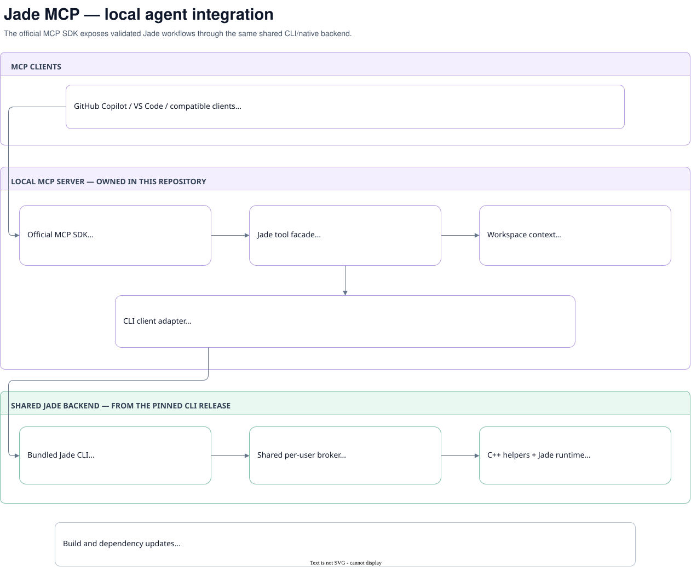

# Jade Local MCP

Local MCP server over the native C++ Jade CLI, using the official MCP TypeScript SDK v2. The server exposes native compile/test and read-only browsing to compatible clients without opening the Jade IDE. Native operations require the configured Windows Jade installation.

## Run the portable server

Download and extract the complete `jade-mcp-win-x64.zip` release. Keep its `bin`, `src`, `skills`, `native` and `node_modules` sidecars next to `jade-mcp.exe`. The MCP protocol adapter still uses the official JavaScript SDK and embeds Node in `jade-mcp.exe`; end users do not need a separate Node installation or VS Code. The separate `native/jade-cli.exe` is C++ and has no Node runtime. No JavaScript CLI/broker is used or included in the runtime bundle.

```powershell
C:\Tools\jade-mcp\jade-mcp.exe --workspace C:\repos\MyJadeProject
```

The server reserves standard output for the MCP protocol and writes errors to standard error. Its shared CLI backend discovers the nearest `jade.json` in the workspace or its parent folders. Paths inside that configuration are relative to the configuration file. `--config <file>` selects another configuration explicitly. Source files are saved files on disk; unsaved editor buffers are not implicitly included.

A minimal VS Code `.vscode/mcp.json` configuration is:

```json
{
  "servers": {
    "jade": {
      "type": "stdio",
      "command": "C:\\Tools\\jade-mcp\\jade-mcp.exe",
      "args": ["--workspace", "${workspaceFolder}"]
    }
  }
}
```

VS Code and other Copilot clients have different configuration file formats. See the [VS Code MCP configuration reference](https://code.visualstudio.com/docs/agents/reference/mcp-configuration) and [GitHub Copilot CLI setup](https://docs.github.com/en/copilot/how-tos/copilot-cli/customize-copilot/add-mcp-servers) for the client-specific location. The server itself uses standard local stdio.

## Tools

| Tool | Purpose |
|---|---|
| `jade_get_guidance` | Read the bundled Jade development skill without opening a database. |
| `jade_doctor` | Check native tool availability and resolved configuration. |
| `jade_build` | Compile selected CLS files or incrementally build the configured project when files are omitted. |
| `jade_test` | Run selected test files and optional method names in the warm native Working session. |
| `jade_list_tests` | Search and page schema-qualified tests from workspace files. |
| `jade_search_source` | Search and page schema-qualified workspace classes. |
| `jade_status` | Read shared broker and native process status. |
| `jade_list_jobs`, `jade_cancel` | Inspect or cancel requests owned by this MCP client. |
| `jade_inspect_catalog` | Search and page database classes and their native OIDs. |
| `jade_inspect_instances` | Read a bounded page of persistent instance identities. |
| `jade_inspect_object` | Read object properties without evaluating arbitrary code. |
| `jade_inspect_collection` | Read paged collection members and dictionary keys. |
| `jade_release_cursor`, `jade_close_inspection` | Release inspection state in its original target/session. |
| `jade_disconnect` | Explicitly release idle shared native sessions. |
| `jade_shutdown` | Explicitly stop the shared user broker and its owned native processes. |

All inspection tools are **read-only for both Source and Working**. They default to `working`; `target: "source"` selects the configured Source database. Class identities are schema-qualified; object OIDs and cursors remain tied to a target/session. Catalogue, test and source queries return bounded pages. Keep the same inspection session when paging a collection and close it before switching database identity.

The data boundary is enforced through strict tool schemas, fixed native inspection operations and Object Manager `DB_READ_ONLY` sessions for both targets. Data tools do not accept arbitrary commands, nested native arguments, configuration overrides, expressions, setters, create/delete requests, transactions, publication or recovery. Catalogue/search text is a filter, not a query language or executable Jade source. Releasing a cursor or closing an inspection session changes transient inspection state only. Read-only annotations describe that boundary; they do not enforce it on their own. Build/test and explicit broker lifecycle tools are separate operations: build/test may change private Working data and are not advertised as read-only.

Native inspection can call the fixed `allowedToInspect` access policy and collection iterator operations. The database's read-only mode protects persistent data; it is not an operating-system sandbox for application callbacks or their external file/network effects. Clients cannot supply arbitrary callback code or method names through data-tool arguments.

Native object identities require an official CLI release advertising `oidFormat: "jade-native"`; this version bundles verified CLI 0.4.2. Native CLI 0.4.2 or later is required for the build and package-loading behavior used by this server. Existing `oid`, `classOid` and nested reference/member/key identity fields carry Jade's `Object.getObjectStringForObject` result unchanged for both targets. MCP does not decode, trim, change case or reconstruct those values. Lookup passes a bounded identity string to the fixed native `String.asObject` parser; native syntax and object lookup determine validity. Input is limited to 512 UTF-8 bytes without ASCII control characters. Legacy 44-hex serialized identities remain input-only compatibility, not native display IDs. Cursor/session/job tokens are separate opaque values and are not converted into Jade identities.

Successful inspection responses must advertise the native identity format; an older backend is rejected before its raw identities can be presented as canonical data. Packaging also requires the capability in the verified official native manifest. Accepting an input string in a protocol test does not establish that it is a valid Jade object identity; the connected native integration proof exercises real lookups separately.

Database catalogue filtering and paging happen in the native helper before its response crosses the transport boundary. Progress output and embedded report logs retain at most their last 32,768 characters; diagnostics, test results and the full native log file path remain available.

Build/test reuse the native CLI broker and its Jade session. C++ owns configuration discovery, dependency selection, successful-input change tracking and native operations. The MCP adapter only validates tool inputs and exchanges JSONL requests with `jade-cli.exe service --stdio`. Results preserve real Jade codes, source diagnostics and individual test failures. A failed build or test is an MCP tool error with a structured result. Cancellation covers owned requests waiting for startup as well as running operations.

Resources `jade://capabilities` and `jade://workspace` describe the actual implemented surface and non-secret resolved workspace identity. Prompt `jade_check_changes` guides a compile/test workflow.

## Agent skill and instructions

The versioned [Jade development skill](skills/jade-development/SKILL.md) is included in every portable distribution. MCP initialization instructions direct agents to read it using `jade_get_guidance` or `jade://skills/jade-development`; the tool supports clients that do not present resources. Both return the same packaged file, without opening a database or starting native work.

The skill covers Source versus Working, native build/test and inspection, saved files versus scratch snapshots, schema-qualified identity, formatting/Error Lens, recovery 3094, collection/designer limits, Workspace/JadeScript semantics and the native CLI architecture. It requires agents to consult installed capabilities rather than treating a plan as an implemented feature. Source recovery is distinct from compilation and publication and must not be performed silently.

Jade is a trademark of Jade Software Corporation Limited. This is independent third-party tooling; the project does not claim official endorsement. Native Jade terminology identifies the compatible platform and its features.

For local Codex discovery, copy the `skills/jade-development` folder into your Codex skills directory (normally `~/.codex/skills/`). Other clients can install the same SKILL.md using their supported skill location or retrieve it through MCP. Server instructions guide the model; they do not grant permissions or guarantee that every host automatically loads resources. No secrets or machine-specific connection settings are included.

Publication, extraction, source authoring, DAP debugging, arbitrary native utilities and object editing are not exposed by this server. Those require additional typed SDK interfaces and, for publication, a user-reviewed plan; an arbitrary model-supplied approval flag is not a substitute. The VS Code extension retains its existing publishing and debugger interfaces.

## Build and test

Development requires the pinned Node v24.22.1 runtime and npm. End users of the release ZIP do not.

```text
npm ci --ignore-scripts
npm test
npm run build
npm run package:standalone
```

`npm test` uses the official MCP client for both in-memory protocol validation and a real stdio server/source-query integration. Default tests never connect to a Jade database. Native connected tests require `JADE_MCP_NATIVE_TESTS=1` and `JADE_MCP_NATIVE_CONTEXT` pointing to a disposable fixture description; the connected test validates its private paths before opening a database. Missing context fails instead of silently skipping an explicit request. To exercise the packaged EXE with Node removed from its PATH, set `JADE_MCP_STANDALONE_EXE` to the generated executable and run the tests again.

The separate native-identity integration proof is explicitly selected with `JADE_MCP_NATIVE_OID_CONTEXT` and `node --test tests/NativeIntegration/NativeIntegration_nativeIdentity_tests.test.js`. Its private fixture description must identify an owned TEMP database, workspace/storage, immutable verified CLI copy and expected hashes. Provision the database through a consistent native backup/restore with isolated INI journal/log/transient paths; copying database files while retaining another fixture's INI paths is rejected. This developer proof does not install a runtime, fabricate an official pin or bypass the release capability guard. It prepares a private Working copy as fixture setup, then exercises the read-only MCP data tools against Source/Working fixture targets.

The official native CLI distribution is committed under `packages/jade-cli-win-x64/`, with its identity and hashes in `distribution.json`. The reviewed release pin records the downloaded ZIP checksum and the exact manifest digest verified during installation. Build/test/package commands verify that receipt and stage only declared files into `native/`. The ZIP checksum is an installation receipt; it cannot be recomputed from extracted files. Normal builds use the committed package. This repository contains neither a second compiler nor a custom MCP protocol implementation. Its own `build-tools/` development package supplies the MCP executable packager and Node license. The lockfile references this committed local directory; no duplicate build-tools archive or legacy JavaScript CLI is installed or shipped.

## GitHub Actions and linked builds

`main` is the default branch and the target for review pull requests. Your code-owner approval is required before merging; automation must open a PR rather than push product changes directly to `main`.

Each pull request runs source validation, protocol tests, Windows executable packaging, a no-Node-PATH executable test and distribution checksum checks. Agent branch pushes create or update one Draft pull request rather than running a duplicate branch build. Implementation, dependency updates and review fixes remain Draft without requesting owner review or queuing auto-merge. Once the work and required checks are complete, the PR can be marked ready, owner review requested and protected squash auto-merge queued. Your approval is still required.

After approval and merge, the single `main` build publishes that tested package as its versioned GitHub release. If that push workflow was not started, run **MCP build and release** from GitHub Actions with **Use workflow from: main**. This recovery path rebuilds and tests the approved main commit, verifies its ancestry, and publishes the verified artifacts; a manual feature-branch run cannot publish. An existing release is reused only after verifying its tag is on reviewed `main` and its published assets match their checksums. Tag pushes do not start duplicate builds or publish releases. Download the complete ZIP: the standalone EXE asset alone still needs its sidecars.

`node scripts/update-cli.js --verify-lock` verifies the release version/tag, manifest receipt and all runtime hashes, including mandatory helpers. `node scripts/update-cli.js` checks the latest stable official CLI release; append a tag such as `v0.3.0` to select one explicitly. The updater and release publisher are small, tested modules owned by this repository. No extension checkout, external workflow reference or additional application token is required. The updater verifies the official release origin, ZIP checksum, size limits, archive paths and native hashes before an atomic install. Downgrades are rejected. An unchanged verified release downloads only its metadata and small checksum file; missing or corrupt local files trigger a verified repair.

The repository schedules a check for new CLI releases every five minutes and also supports a manual update run. GitHub schedules are best effort: a configured interval does not guarantee a run or an update within five minutes. A new dependency bumps the MCP patch version once and opens a bot-authored Draft PR; repairing the same dependency does not bump it. The normal PR workflow performs the full build/test/package validation once. Owner review and protected squash auto-merge are requested only after readiness; the resulting approved `main` build publishes the consumer version. Enable GitHub Actions' permission to create pull requests; its existing repository token is sufficient. Updating the dependency never publishes to a Source database. Editable diagrams and source are tracked; research notes, credentials, databases, caches, execution reports and generated distributions stay outside Git.

## Architecture diagram



[Edit the diagram in draw.io](docs/architecture.drawio). The SVG is the rendered companion to the editable source.
